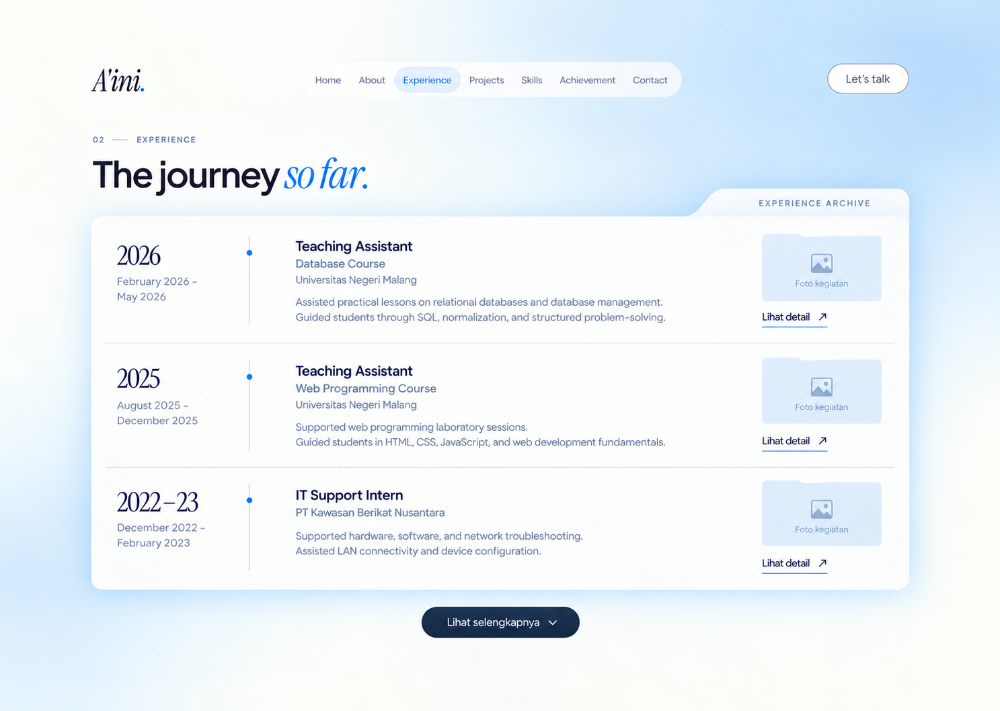
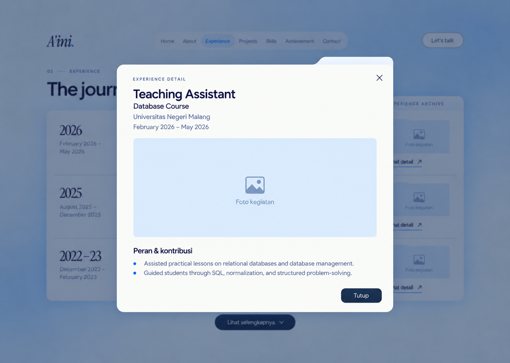

# Experience — approved design handoff

Approved by the user on 21 October 2026. This handoff contains the chosen visual target and the user's final changes. The website has not yet been changed by this design task.

## Implementation request

Implement the approved compact Experience section in this existing Next.js portfolio. Inspect the reference images below, read the repository's AGENTS.md and relevant guides in node_modules/next/dist/docs/, inspect the current working tree, and continue in the existing project. Preserve unrelated changes, including staged Home/About work. Do not scaffold another app, replace the project, or reopen broad design exploration.

The final user instructions override the screenshots: REMOVE the small "02 — EXPERIENCE" eyebrow entirely, including its separator, and add a multi-photo carousel INSIDE the experience detail dialog. Keep the heading "The journey so far." with the blue serif italic accent. Do not remove numbering from other sections.

## Authoritative visual targets

- [Approved compact overview](experience-overview-approved.png).
- [Approved dialog appearance](experience-dialog-approved.png). Add carousel controls and behavior to this dialog when photos exist.
- [Existing About](about-style-reference.png) and [existing Home](home-style-reference.png) establish the shared visual system.

Use the compact overview above, not the earlier all-right timeline, alternating text/photo panels, or oversized cards. The user rejected large cards and oversized text, then approved this compact archive index.

## Visual requirements

- A single wide, milky-white archive sheet with a small integrated tab, "EXPERIENCE ARCHIVE", and three compact horizontal rows initially. Separate rows with fine rules rather than three bulky containers.
- Each desktop row has a narrow year/date column, the role and contribution text, and a small photo thumbnail shaped subtly like a folder inside the same row. Photography must not occupy a separate large panel beside the experience.
- Use generous horizontal space with modest row height. At desktop widths, aim for a content width near 1120–1160px, row height around 155–180px as content permits, and thumbnails around 160–180px wide by 90–105px tall. Allow content to determine height; never clip text to force these dimensions.
- Keep type restrained: heading about 40–44px, role 18–20px, course subtitle about 15px, body 14–16px, dates 13–14px, years about 28–32px. Respect the project's existing root font scaling; compare rendered sizes rather than blindly copying rem values.
- Continue warm white #fafbf7, powder blue #b7daf6, navy #152c49, slate #526887, and cobalt #096bf0. Use the existing Plus Jakarta Sans and Instrument Serif fonts. Shadows and frosted edges remain subtle; text areas stay readable.
- On narrow screens, stack each row's date, text, and thumbnail naturally. Preserve chronological reading order and avoid horizontal page overflow. No sticky left heading, internal scroll container, giant empty hero, or separate alternating photo panels.
- Keep the existing navbar and the Home/About layout intact. Use section-scoped styles for Experience and its dialog.

## List behavior

- Preserve the #experience anchor and accessible heading association.
- Show the latest 3 experiences initially. Make the initial count easy to configure to 5 without rewriting components.
- When there are more records than the configured initial count, show "Lihat selengkapnya" after the list. Clicking reveals the remaining records inline on the same page, preserving natural document scrolling. This is not pagination or navigation to a new route.
- Hide that button when the complete list already fits. There are currently only 3 real records; do not invent additional jobs to make the button appear.
- Each row exposes an explicit "Lihat detail" action. Clicking that action or its thumbnail opens the corresponding detail dialog. Hover can gently emphasize the thumbnail but must not be required to discover or read information.

## Detail dialog and photo carousel

- Show the selected experience's role, optional course subtitle, organization, exact period, contributions, and documentation gallery within one dialog. Keep the rounded archive-paper styling from the approved modal image, with modest typography.
- Support any number of approved activity photos per experience using an ordered gallery array with source, dimensions, meaningful alt text, and optional caption. The first photo can supply the row thumbnail.
- With multiple photos: show previous/next controls, a current position indicator, and the current photo/caption. Support touch swipe and keyboard left/right when the gallery is focused. Start at the first photo whenever a different experience opens. Do not autoplay.
- With one photo: show it without redundant carousel controls or a misleading multi-photo count.
- With no photos: show a deliberately styled empty photo slot or folder thumbnail and a corresponding empty gallery area in the dialog. Do not fabricate documentary photos, repeated dummy slides, file paths, or photo counts.
- All three current entries may remain without actual media until the owner adds approved photos. Keep missing media optional and future photo additions straightforward.
- Provide a labelled close control and the visible "Tutup" button. Support Escape to close, contained keyboard focus, restoration of focus to the triggering control, and sensible background scroll locking. Handle small-screen dialog overflow internally while keeping the close control reachable.
- The "Lihat detail" dialog and "Lihat selengkapnya" list expansion are distinct actions with distinct effects.

## Existing code to inspect

- src/components/sections/Experience.tsx currently renders a SectionHeading with number="02", followed by plain timeline rows. Replace the Experience presentation while retaining its anchor and factual data.
- src/data/experience.ts contains the three approved real records. Preserve all dates, organizations, and contributions. Add stable IDs and optional media fields as needed; existing role strings contain the course names.
- src/app/layout.tsx establishes the font pair and stylesheet order. src/app/hero-about.css and src/app/archive.css provide the current Home/About materials and colors.
- src/components/projects/ProjectGallery.tsx already uses embla-carousel-react, touch navigation, focused gallery arrow keys, and image placeholders. Reuse an appropriate shared pattern or extract a narrowly scoped reusable gallery if it avoids regressions; do not assume the entire project component suits the Experience dialog unchanged.
- src/components/projects/MediaLightbox.tsx already demonstrates photo enlargement behavior, but the requested Experience view is a role-detail dialog containing a carousel, not just an image-only lightbox. Avoid nested modal conflicts.
- Existing dependencies include embla-carousel-react, yet-another-react-lightbox, lucide-react, motion, GSAP, and next/image. Prefer existing capabilities over installing another carousel package.

## Real content to preserve

1. February 2026 – May 2026: Teaching Assistant — Database Course, Universitas Negeri Malang. Assisted practical lessons on relational databases and database management. Guided students through SQL, normalization, and structured problem-solving.
2. August 2025 – December 2025: Teaching Assistant — Web Programming Course, Universitas Negeri Malang. Supported web programming laboratory sessions. Guided students in HTML, CSS, JavaScript, and web development fundamentals.
3. December 2022 – February 2023: IT Support Intern, PT Kawasan Berikat Nusantara. Supported hardware, software, and network troubleshooting. Assisted LAN connectivity and device configuration.

These roles have ended. Do not label them Present, Current, or Now.

## Validation and completion

- Check desktop and phone rendering against the approved compact image, allowing only the explicit label removal, carousel additions, and responsive adaptation. Check density, modest font sizes, thumbnail scale, padding, and the transition from About.
- Verify actual dialog opening, correct record selection, closing, focus restoration, Escape, and background scroll behavior.
- Verify zero/one/multiple-photo behavior, carousel next/previous, keyboard use, and touch swipe where supported. Use clearly synthetic test fixtures for extra photos or experience records without adding fake content to production data.
- Verify initial counts of 3 and 5 and inline expansion with a larger fixture. Verify the expansion action is absent for the current three-record production list.
- Run relevant existing typecheck, lint, and build checks, plus focused interaction tests justified by the new modal, carousel, and expansion behavior. Reuse the repository's established test setup.
- Preserve reduced-motion support and native controls/semantics. Do not claim accessibility solely from a screenshot.
- Deliver the running local preview and a concise account of what changed, what was verified, and how to add real photos. Do not deploy or publish unless separately requested.

## Status at handoff

Only this handoff and its copied reference images were added. The approved design is ready for implementation. No frontend implementation, carousel, or label removal has been applied yet.
