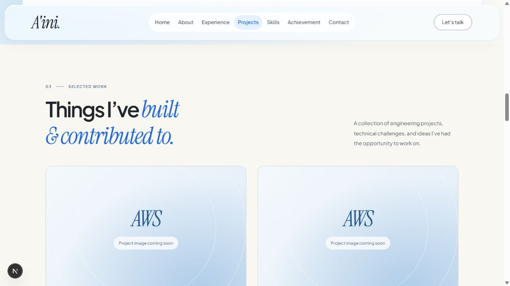
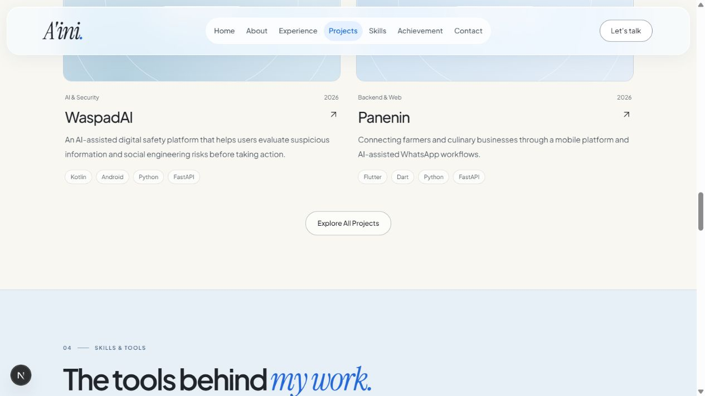

# Empat selected projects — cek keselarasan

21 Oktober 2026. Pemeriksaan desktop pada viewport normal sekitar 1264px lebar. Perubahan yang sudah diterapkan: homepage kini memakai empat featured projects teratas saja; halaman koleksi lengkap tetap memuat 11 proyek. Style belum diubah pada pass ini.

## 1. Jumlah dan susunan — sudah sesuai

Empat kartu: AWS Serverless Ticketing Architecture, AWS Infrastructure Automation & Recovery, WaspadAI, dan Panenin. Grid dua kolom sekarang membentuk dua baris. Tinggi grid turun dari sekitar 1649px menjadi 1105px. Kartu kelima dan keenam tidak lagi muncul di homepage; data proyek tetap utuh.

## 2. Akhir section dan jalur lanjutan — sudah sesuai

Tombol Explore All Projects berada setelah WaspadAI dan Panenin. Klik menuju /projects dan status koleksi menampilkan Showing 6 of 11 projects, sesuai pemuatan awal koleksi lengkap. Pemeriksaan HTTP seluruh halaman dan pemeriksaan lint untuk file yang berubah lulus.

## 3. Keharmonisan visual — perbaikan yang direkomendasikan

| Elemen | Terukur saat ini | Acuan penyesuaian |
|---|---|---|
| Judul section | sekitar53px; Experience sekitar44px | 40–44px di desktop; tetap serif biru pada aksen |
| Nama proyek | sekitar27px | 18–20px supaya judul panjang tidak mendominasi |
| Body ringkasan | 14px, beberapa proyek3baris | pertahankan14–16px, tulis ringkasan editorial dua baris |
| Tag teknologi | sekitar10.5px | naikkan ke12px agar tetap terbaca; cukup2–3tag utama |
| Cover | sekitar504x315px pada lebar audit, rasio1.6 | sedikit lebih mendatar16:9; diagram asli tetap ditampilkan utuh |
| Lebar isi Projects | 1036px, tepi kiri sekitar114px | samakan garis konten dengan Experience yang lebarnya1152px dan tepi kirinya56px pada viewport ini |
| Jarak grid | horizontal28px, vertikal42px | horizontal sudah baik; vertikal sekitar32–40px untuk dua baris yang lebih rapat |
| Aksen biru | gaya Projects masih memakai #2468d8 | samakan dengan #096bf0 dari Experience dan Home |

Latar Projects masih lebih krem dan rata. Lanjutkan putih hangat serta cahaya biru yang sangat lembut dari Experience, dengan teks navy, tab kecil dan bayangan tipis. Bentuk kartu tetap ringan; tidak perlu folder3D besar di setiap proyek. Label03 SELECTED WORK bisa dilepas agar mengikuti perlakuan Experience, sementara kata outline PROJECTS samar dapat menjadi penghubung visual.

Dua cover AWS pertama saat ini identik sehingga baris pertama terasa berulang. Prioritas terpenting untuk tahap desain adalah media yang relevan dan berbeda per proyek: diagram arsitektur untuk cloud, screenshot produk untuk aplikasi. Jangan mengganti semua cover dengan dekorasi folder yang sama dan berharap identitas proyek sudah cukup terbaca. Bila memakai placeholder sementara, beri nama proyek yang lengkap dan penanda media belum tersedia.

Kartu disarankan menyatukan cover dan keterangan dalam permukaan putih susu yang sama. Lihat detail tetap menuju case study yang sudah ada. Tombol koleksi bisa mengikuti navy pill dari Experience untuk memperkuat keselarasan.

## Batas dan status

Pemeriksaan ini memastikan empat kartu dan navigasi koleksi secara langsung pada desktop, disertai ukuran dan warna dari halaman. Belum ada validasi mobile atau audit aksesibilitas menyeluruh. Teks kategori dan tag kecil menjadi risiko keterbacaan yang perlu diperbaiki saat styling. Perubahan kode dibatasi pada jumlah kartu homepage dan pembaruan ekspektasi pemeriksaan yang terkait; tidak ada desain ulang atau deployment.
